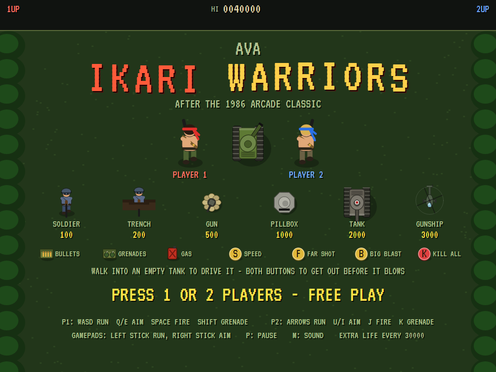
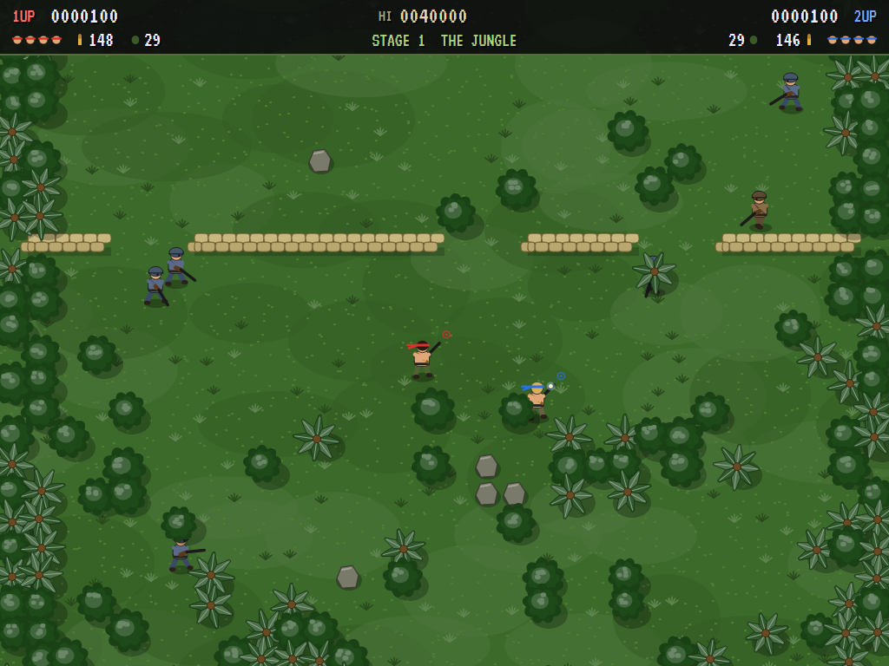
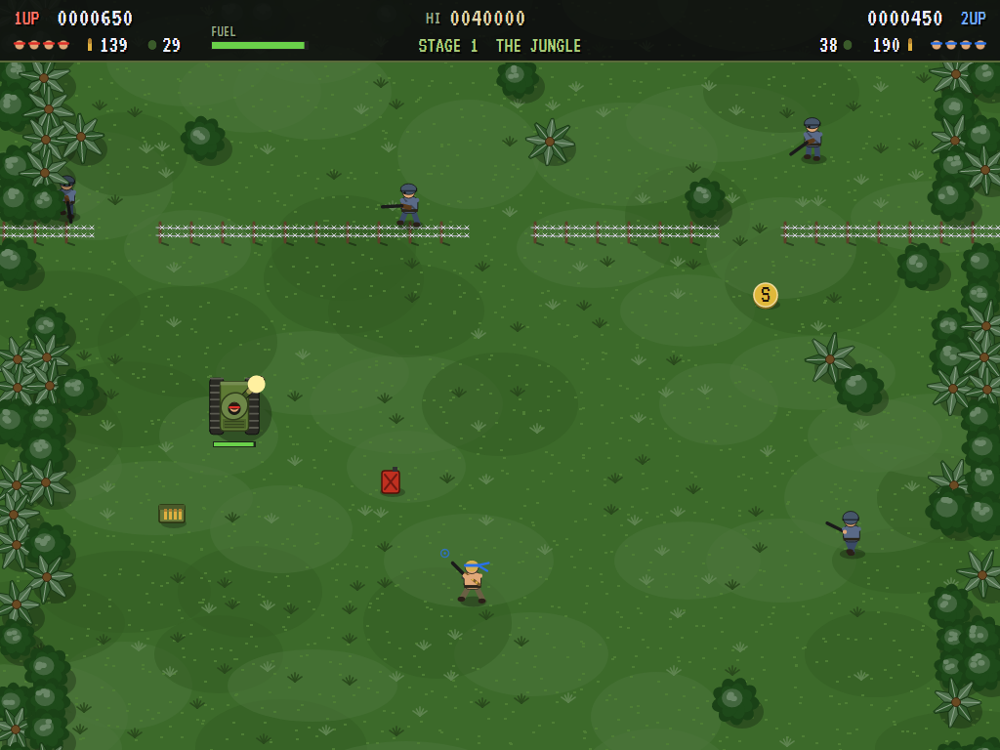
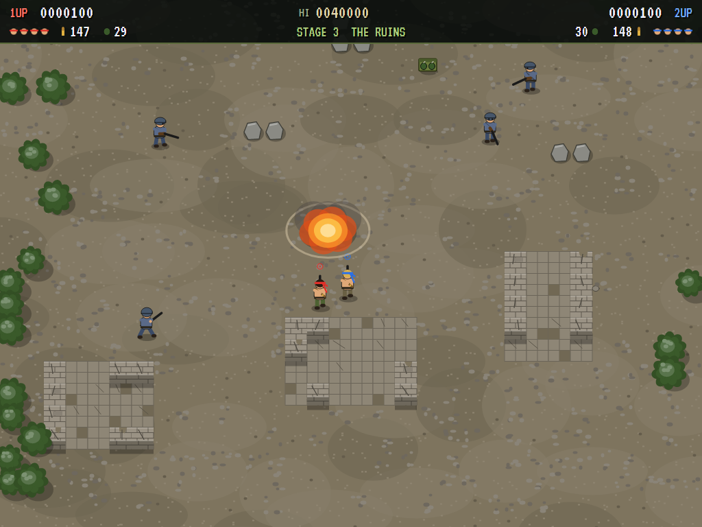
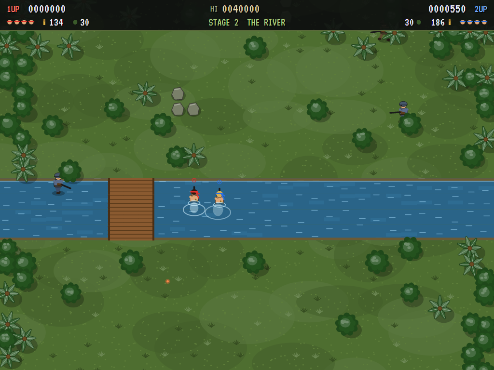
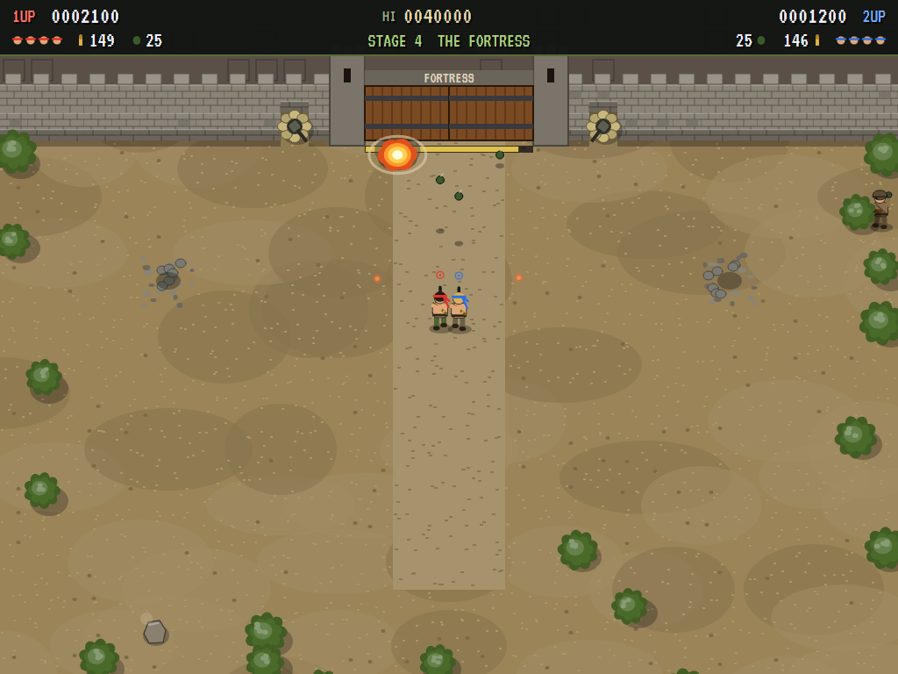
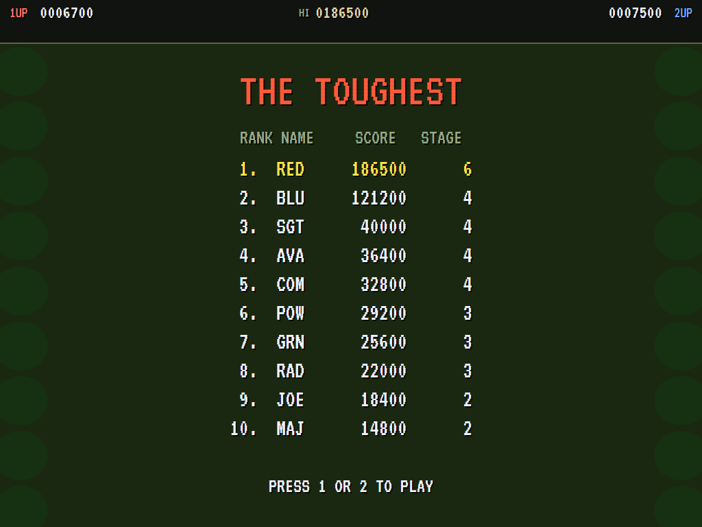

# AVA Ikari Warriors

[](https://github.com/Harlock123/AVAIkariWarriors/actions/workflows/build.yml)

A two-player run-and-gun war game in the style of SNK's 1986 arcade game **Ikari Warriors**, built with .NET 10
and Avalonia UI. Two commandos, one in a red bandana and one in a blue, fight their way north side by side:
through the jungle, across the river, through the ruins and up to the gate of the enemy's fortress. Each one
aims apart from where he runs, as the arcade's rotary joystick allowed, with a gun that can run dry and grenades
that arc over cover. Empty tanks wait along the way: climb in, drive over the enemy, and get out before one runs
dry and blows.

## Features

- **Two commandos, side by side.** Player 2 can join at any time with his own score, lives and supplies; with
  one player, the second commando simply isn't there. The screen follows the one in front but waits for the one
  behind.
- **Aiming apart from running**, the way the rotary stick worked:
  - he aims the way he runs, except while he's firing, which holds the aim where it is (so he can back away
    shooting, or strafe)
  - two keys (or the bumpers) swing the aim a step round at any time, running or not
  - on a gamepad the right stick points the aim straight at one of the eight ways, and fires
- **Supplies run out.** Every bullet is counted (150 to start, four in the air at most); grenades too (30).
  Grenades are thrown a fixed distance the way he aims, over walls, sandbags and rivers, and go off in an area.
  Boxes of bullets (+60) and grenades (+10) lie about, and fallen soldiers sometimes drop them.
- **The letters**, kept until he falls: **S** speed, **F** bullets that fly further, **B** bigger grenade
  blasts; a red can of **gas** fills a tank's fuel; **K** takes out every soldier on the screen.
- **Tanks.** Walk into an empty one to climb in. It has its own fuel gauge, which empties as it drives, and its
  own armour, which enemy fire wears down instead of the man inside. Its cannon fires shells that go off at what
  they hit. It runs soldiers down and rolls sandbags and wire flat, but it can't swim: rivers need the bridge.
  When the fuel runs out or the damage is too much it catches fire, and a few seconds later it goes up: press
  both buttons to get out, and get clear.
- **The ground:**
  - jungle and palms (cover you walk under), rocks
  - rivers he wades, slowly (and can't throw from), with one bridge
  - lines of sandbags with gaps; barbed wire that bullets fly through but men don't (a grenade or a tank clears it)
  - trenches the enemy hides in, and stone walls with gaps a tank can drive through
  - ruined buildings with their doorways and broken walls
- **The enemy:**
  - **Soldiers** (100) run to a spot near you, stop, aim and fire; **grenadiers** (150) lob grenades over cover.
  - **Men in trenches** (200) bob up to fire. A bullet only finds them when they're up; a grenade always does.
  - **Gun emplacements** (500) swing round to follow you. Bullets or a grenade take them out.
  - **Pillboxes** (1000) fire a spread of three. Only a grenade or a tank's shell will do.
  - **Tanks** (2000) roll down the map, shell you, and run down anyone on foot. Bullets glance off.
  - **Gunships** (3000) hover, firing bursts and dropping bombs. Bullets wear them down.
- **Four stretches of the war**: the **Jungle**, the **River**, the **Ruins** and the **Fortress**. Each ends with
  its guard: a gunship, a pair of tanks, both. The fortress ends at its gate, guarded by guns on the wall:
  blast it open with grenades or shells. **The gate opens**, the commandos march in, and the war starts over,
  the same ground but harder: faster soldiers, better shots, tougher armour, more of them.
- **Lives and carrying on.** Three lives each, an extra one every 30000. Out of lives, a player has ten seconds
  to press his start button and carry on, keeping his score (free play). The game ends when both are out.
- **The attract mode** plays itself, touring the stages, with both commandos and then one. The computer player:
  - turns the gun on anything lying along one of the eight ways while it goes about its business
  - climbs into empty tanks, and out again before they blow
  - stands a grenade's throw from pillboxes, tanks and the gate, and lobs one
  - steps out of the way of bullets, bombs and shells
- **The sounds** are all synthesised: rifle bursts, grenades, the tank's diesel and cannon, the gunship's rotor,
  splashing through the river, the enemy's cries, and two public-domain tunes (see [About](#about-and-licence)).

## Screenshots

| The title | Side by side in the jungle | In a tank |
|:---------:|:--------------------------:|:---------:|
|  |  |  |
| The enemy, and the pickups. | Sandbags ahead, the enemy behind them. | Player 1 at the controls. |

| A grenade going off | Across the river | The fortress gate |
|:-------------------:|:----------------:|:-----------------:|
|  |  |  |
| In the ruins. | Wading, slowly. | Blasting it open. |

| The high scores | | |
|:---------------:|:-:|:-:|
|  | | |
| The toughest. | | |

The screenshots are made by the tests, which play the game in a real (headless) window; see
[Tests](#tests).

## Download and run

Ready-to-run builds for Windows, macOS and Linux, on both Intel/AMD and ARM, are on the
[Releases page](https://github.com/Harlock123/AVAIkariWarriors/releases/tag/latest). **Latest build** is
rebuilt on every push to `main`. Each download is one self-contained executable: no .NET install is
needed.

| Platform | Archive |
|---|---|
| Windows | `AVAIkariWarriors-win-x64.zip`, `AVAIkariWarriors-win-x86.zip`, `AVAIkariWarriors-win-arm64.zip` |
| macOS | `AVAIkariWarriors-osx-arm64.tar.gz` (Apple silicon), `AVAIkariWarriors-osx-x64.tar.gz` (Intel) |
| Linux | `AVAIkariWarriors-linux-x64.tar.gz`, `AVAIkariWarriors-linux-arm64.tar.gz`, `AVAIkariWarriors-linux-arm.tar.gz` |

```bash
tar -xzf AVAIkariWarriors-linux-x64.tar.gz     # or linux-arm64, linux-arm, osx-arm64, osx-x64
./AVAIkariWarriors
```

On Windows, unzip and run `AVAIkariWarriors.exe`. On macOS, if Gatekeeper refuses to open it, run
`xattr -d com.apple.quarantine AVAIkariWarriors` once. Run with `--no-audio` for silence.

**Sound** comes through OpenAL Soft, built in for every platform. In a virtual machine the game
detects it and uses a larger audio buffer, so the sound doesn't break up.

**Gamepads** (one for each player) use SDL2, which is bundled for Windows, macOS and Intel/AMD Linux. ARM
Linux builds need it installed; without it the keyboard still works:

```bash
sudo apt install libsdl2-dev            # Debian / Ubuntu / Raspberry Pi OS
sudo pacman -S --needed sdl2-compat     # Arch / Omarchy
```

## Controls

Both players share the keyboard, on keys that never overlap; each gamepad belongs to one player.

| Action | Player 1 keys | Player 2 keys | Gamepad |
|---|---|---|---|
| Start / join / carry on | 1 or Enter | 2 | Start |
| Run (eight ways) | W A S D | Arrow keys (or number pad 8 4 6 2) | Left stick / D-pad |
| Swing the aim a step (anticlockwise / clockwise) | Q / E | U / I (or number pad 7 / 9) | Left / right bumper |
| Aim straight at a way (and fire) | | | Right stick |
| Fire (holding it holds the aim) | Space or F | J (or number pad 0) | A or right trigger |
| Grenade (in a tank, also fires) | Left Shift or G | K, Right Shift (or number pad .) | B or left trigger |
| Out of a tank | Fire and grenade together | Fire and grenade together | Y |
| Pause | P or Esc | P or Esc | Start |
| Quit (while paused) | Esc | Esc | Back |
| Sound on/off | M | M | |
| Screenshot | Ctrl+S (to your Pictures folder) | | |

On the high-score table, type your initials, or use up/down and Space, then Enter.

## Tests

```bash
dotnet test AVAIkariWarriors.slnx
```

The engine has no UI and runs in fixed 60 Hz steps, so it plays the same at any frame rate, and a seed
always plays the same game. The tests check:

- **The map:** every stage a way up through its ground to its end (or the gate), with two tanks and gas on the
  way; the four stretches in turn and the second round on the same ground, more heavily held; rivers with a
  bridge, wire, trenches, ruins and walls where they belong
- **Running and aiming:**
  - running eight ways and aiming the way he runs, but not while firing
  - turning the aim a step at a time, whichever way he runs; a right stick pointing it
  - rocks stopping him, wading a river slowly and throwing nothing from it
- **The gun and the grenades:**
  - every bullet counted, four in the air at most, none when he's out, and a box of them
  - grenades counted, thrown a fixed distance the way he aims, over a wall, taking out whoever's where they land
  - sandbags stopping bullets but wire and water not, and a grenade blowing the wire away
  - the letters S, F and B, lost when he falls; K taking out every soldier on the screen
- **Tanks:**
  - walking in, driving, firing shells, and getting out beside it with both buttons
  - running soldiers down, flattening sandbags and wire, staying out of the water
  - its fuel burning, and going up with him in it when it runs dry
  - getting out of a burning tank in time, and its blast taking the enemy round it
  - enemy fire wearing the tank down instead of the man in it, and gas filling it up
- **The enemy:** a rifleman's shot, a man in a trench out of reach until he bobs up, a grenadier's lob over cover,
  a gun emplacement falling to bullets and a pillbox only to a grenade, a tank shrugging off bullets, shelling
  and running a man down, and a gunship's bursts and bombs
- **Two players:** joining at any time with their own supplies, each scoring his own, the screen waiting for the
  one behind, and each player's controls moving only him
- **The machine:**
  - extra lives; carrying on with the score kept, or the game ending and initials (for both players)
  - the screen following up but never back, and the enemy in the map coming on as the screen reaches it
  - a stage's guard and the stage taken; the fortress gate blown, the finale and round two, harder
  - the title, the demonstrations (two commandos, then one) and the high scores; one or two to start
  - the computer player taking the jungle alone, and two of them the river together
  - the same game from the same seed, and pausing
- **The keys**, through the input handler: each player's, none shared, up on the keys up the map in the game,
  joining with 2, and a key (or a Shift) let go under another name

The screenshot tests draw the real screen in a headless window. To refresh the README's pictures:

```bash
IKARI_SHOTS=$PWD/Images dotnet test tests/AVAIkariWarriors.Tests --filter ScreenshotTests
```

To see how the computer players get on, stage by stage (the march to the end, and the fight there; `1` for one
commando, `2` for both, `lazy` for one that just runs up the screen firing ahead):

```bash
IKARI_PROBE=2 dotnet test tests/AVAIkariWarriors.Tests --filter PilotProbe --logger "console;verbosity=detailed"
```

## Building

```bash
dotnet build AVAIkariWarriors.slnx
dotnet run --project src/AVAIkariWarriors
```

Needs the .NET 10 SDK. The sounds are made by `tools/make_sounds.py` (standard-library Python):
`python3 tools/make_sounds.py` rewrites `src/AVAIkariWarriors/Sounds`.

## Project structure

```
AVAIkariWarriors/
├── AVAIkariWarriors.slnx
├── src/AVAIkariWarriors/
│   ├── Engine/
│   │   ├── GameEngine.cs          # States, joining and carrying on, the title and demo cycle, initials
│   │   ├── GameEngine.Play.cs     # The commandos: aiming, the gun and grenades; tanks; pickups; the scrolling;
│   │   │                          # blasts and what they hit; the end of a stage, the gate and the finale
│   │   ├── GameEngine.Enemies.cs  # Reinforcements; soldiers, trenches, tanks, gunships, guns and pillboxes
│   │   ├── WarriorPilot.cs        # The computer player, for the demonstration (and the tests)
│   │   ├── Entities.cs            # The controls; the stages and how their maps are built; everything in them
│   │   ├── HighScoreTable.cs, InitialsEntry.cs
│   │   ├── InputHandler.cs, ControllerManager.cs  # Both players' keys, and an SDL2 gamepad each
│   │   └── SoundManager.cs        # Effects and the tunes through OpenAL
│   ├── Audio/                     # The OpenAL engine (from the author's AVABand)
│   ├── Views/                     # The drawing: GameCanvas.Draw.cs the war, GameCanvas.Screens.cs the
│   │                              # score bar, the title, the scores and the initials
│   └── Sounds/                    # The synthesised effects and tunes
├── tests/AVAIkariWarriors.Tests/  # Gameplay, input, screenshot and probe tests
├── tools/make_sounds.py
└── Images/                        # Screenshots
```

## About and licence

AVA Ikari Warriors © 2026 Lonnie Watson, under the [MIT License](LICENSE).

*Ikari Warriors* © 1986 SNK; the name belongs to its current owner. AVA Ikari Warriors is an independent,
unofficial game in its style. Its commandos, maps, enemies and fortress, its graphics, sounds and code are
its own; nothing is taken from the arcade machine's program, graphics, sound or music. It is not affiliated
with or endorsed by any rights holder.

The title plays **"Yankee Doodle"** (traditional, 18th century) as a fife and drum march, and game over is the
bugle call **"Taps"** (Daniel Butterfield, 1862); both are in the public domain, and both are arranged and
synthesised here by `tools/make_sounds.py`. The other tunes are original.
